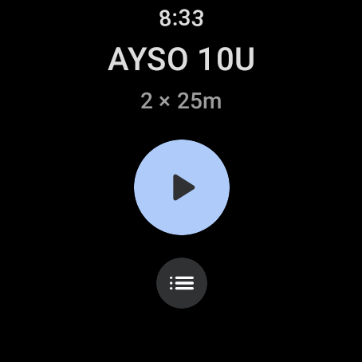
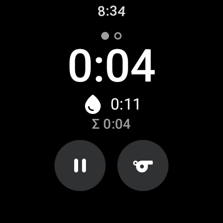
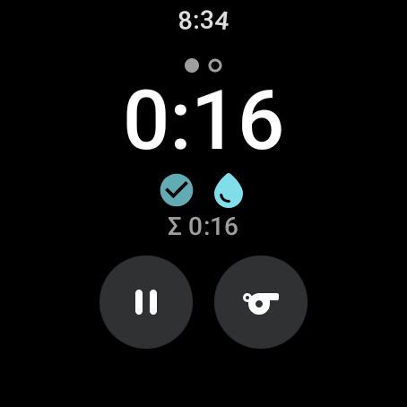
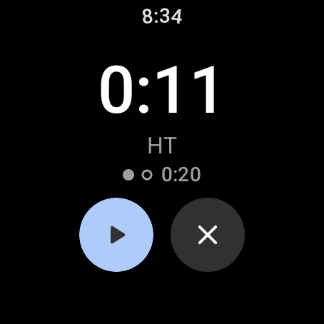
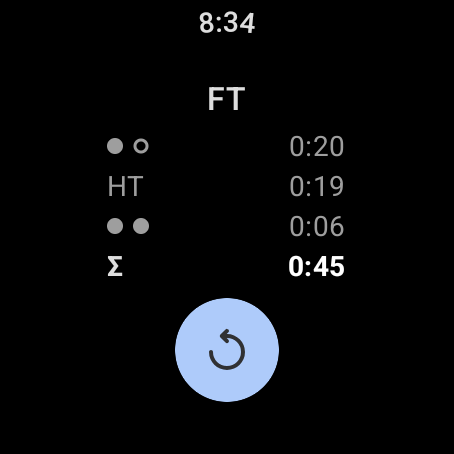
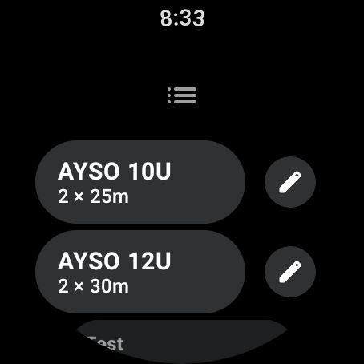
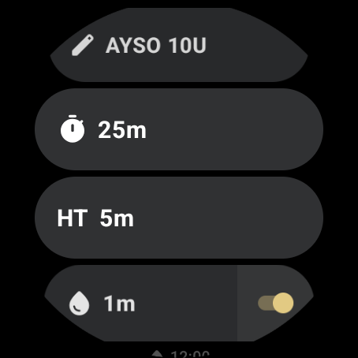
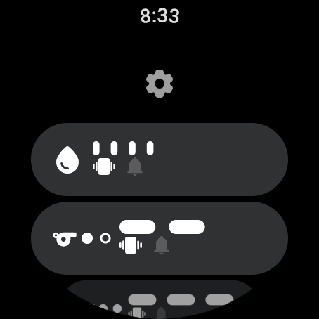

# RefClock

A match clock for soccer referees, on Wear OS. It runs on the watch alone, and buzzes your wrist
at the moments that matter: the water break, the end of each half, the end of halftime.

<p>
  
  
  
  
  
</p>
<p>
  
  
  
</p>

## Features

- **Half clock** that counts up from 0:00 and keeps running past the half length, turning amber.
  The second half restarts at 0:00; a small **Σ** line shows game time.
- **Water break** placed so both quarters get equal playing time: it starts at
  (half − break) ÷ 2, so 12:00 in a 25-minute half with a 1-minute break.
- **Halftime timer** that counts down (or up, in Settings) and alerts when halftime is over.
- **Alerts that repeat until you tap**, capped at about a minute. Each alert gets its own
  pattern (seven to choose from), and can vibrate, beep, or both. They fire on time with the
  screen off.
- **Full time summary**: each half, halftime, and the total.
- **Profiles** for different leagues: half length, halftime length, and the water break (on or
  off, and its length). AYSO 10U and 12U come built in and can be edited, deleted and restored.
- **Built for use mid-run**: raising your wrist returns to the clock, a watch-face indicator
  reopens the match, Pause and End half need a hold so a stray touch can't stop the clock, and
  the screens use icons rather than words.
- **No phone, no network, no account.** Everything stays on the watch.

## Install

RefClock needs Wear OS 3 or later. It's developed on a Pixel Watch 4.

1. On the watch: Settings → System → About → tap Build number 7 times, then Settings → Developer
   options → turn on ADB debugging and Wireless debugging.
2. Wireless debugging → Pair new device, then on the computer:

```sh
adb pair <ip>:<pairing-port>     # enter the code shown on the watch
adb connect <ip>:<port>
adb install -r RefClock.apk
```

## Build

Open the project in Android Studio, or from the command line:

```sh
./gradlew test               # unit tests for the match, profile and alert logic
./gradlew assembleDebug      # app/build/outputs/apk/debug/app-debug.apk
./gradlew assembleRelease    # app/build/outputs/apk/release/app-release.apk
```

Debug builds add a **Test** profile (30-second halves, 15-second halftime) for trying the alerts
quickly. Release builds are optimized and shrunk, and launch noticeably faster. Until the app has
a Play Store key, release builds are signed with the debug key, so either kind installs over the
other.

## How it works

- `match/` is plain Kotlin with no Android dependencies, covered by unit tests: the match state
  (`Match.kt`), profiles and the break rule (`Profiles.kt`), and alert patterns and timing
  (`AlertSettings.kt`, `BeepTone.kt`).
- `MatchController` owns the match state and saves it, so a match survives the app restarting.
  Times are measured with `SystemClock.elapsedRealtime()`, so a clock sync mid-match can't shift
  them. That clock resets when the watch reboots, so a half in progress is lost then; at halftime,
  the first half's result is kept and the halftime clock starts over.
- Alerts are exact system alarms (`AlertScheduler`, `AlertReceiver`), so they fire with the
  screen off and without keeping the CPU awake. `AlertPlayer` plays the vibration and the beep
  from the same pulse schedule.
- `MatchService` is a foreground service with an Ongoing Activity, which keeps the match on the
  watch face. Ambient mode support is what brings the clock back on wrist raise.
- Profiles and settings are JSON files written atomically (`ProfileStore`, `SettingsStore`).
- The UI is Compose for Wear OS (`ui/`).

## Privacy

RefClock has no internet permission and collects nothing. Profiles, settings and the current
match are stored only on the watch.

## License

Copyright 2026 Raj Sahae. Licensed under the [Apache License, Version 2.0](LICENSE).

Icons are from Google's [Material Symbols](https://github.com/google/material-design-icons),
also under the Apache License, Version 2.0.
